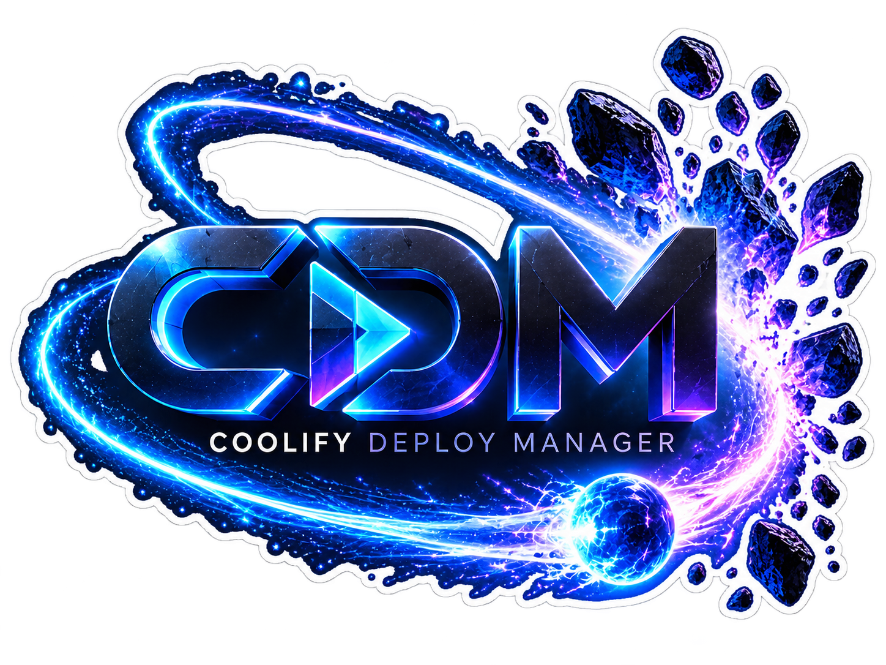
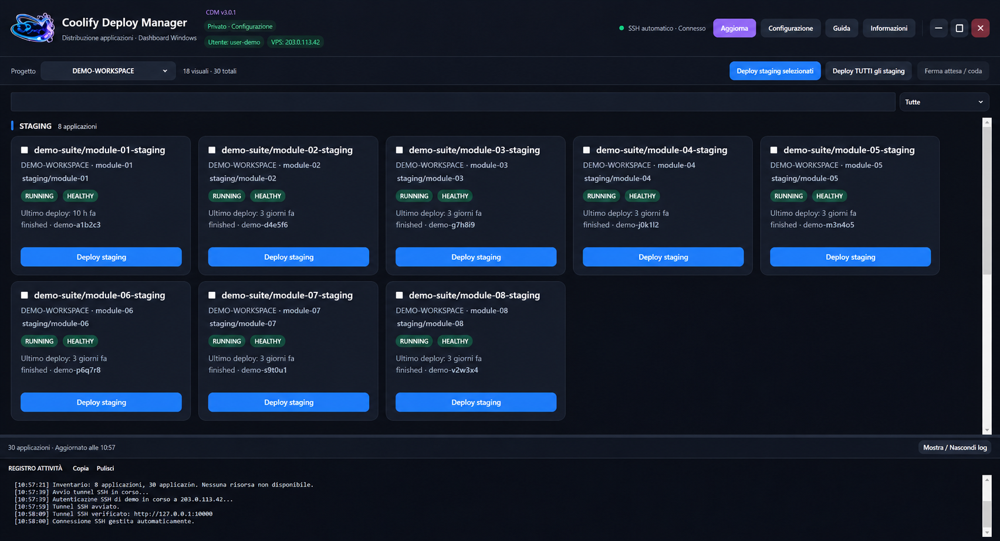
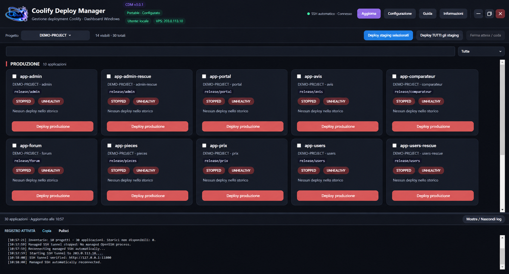

# CDM — Coolify Deploy Manager

**Version 3.0.2 — Windows 10/11 x64 — independent, unofficial Coolify companion.**

**Release status:** source snapshot prepared and verified locally; the public v3.0.2 GitHub release has **not** yet been published. Download links will become available under [Releases](https://github.com/Cris0338/CDM-Coolify-Deploy-Manager/releases) after publication.

<p align="center"></p>

Created by **[Cris0338](https://github.com/Cris0338)**. CDM is not affiliated with or endorsed by Coolify. [Italiano](README_IT.md) · [Setup guide](CDM_SETUP_GUIDE.md) · [Building](BUILDING.md) · [License](LICENSE) · [Optional support](SUPPORT.md).

## Features

- See Coolify applications and projects, classification by staging/production, status and recent deployment activity.
- Start explicitly chosen deployments; show per-card progress, deployment log lines, and taskbar/tray activity.
- Reorder cards, lock positions or deployments, and remember the selected project and window placement.
- Open an independent setup wizard and companion Guide; use a dedicated Windows startup registry manager.
- Connect to a trusted HTTPS endpoint, private LAN/VPN, or use a managed SSH tunnel to a Coolify loopback service.
- English, French and Italian complete; additional languages have partial translations with English fallback.

## Dashboard previews

These images use **illustrative, anonymized data**, not a live server connection.





## Generic EXE versus personal EXE

The **generic** `CDM-v3.0.2.exe` starts unconfigured. It contains no account, API token, SSH key or personal host configuration. This is the ONLY type of EXE intended for publication.

The **personal** `CDM-<user>-<server>-v3.0.2.exe` stores the selected server, Coolify token, restricted SSH key and host fingerprint where applicable, and application preferences in its own executable. Its profile is portable and **not encrypted**: do not distribute personal clones or their backups.

## First configuration

1. Launch the generic `CDM-v3.0.2.exe`; the wizard and Guide open independently.
2. Choose direct trusted HTTPS, private LAN/VPN, or managed SSH forwarding for an HTTP-only public VPS.
3. For managed SSH: enter VPS hostname, your existing Linux administrator login, SSH port, and local forward port (typically `18000`); use loopback destination `127.0.0.1:8000` unless your Coolify configuration differs.
4. Generate a dedicated Ed25519 key, copy the VPS provisioning command, and run it from an authorized server terminal. CDM sets up a separate restricted `<admin>-cdm` user, rather than reusing your administrator's SSH identity.
5. Independently verify the SSH host fingerprint. Check that restricted forwarding works and a remote Linux shell cannot be executed.
6. Create a Coolify API token limited to **READ + DEPLOY** without ROOT, WRITE or READ:SENSITIVE. The initial API check is read-only and does not test deployment authority.
7. Finish the wizard to create your own personal EXE. A deployment only occurs when you deliberately trigger one.

See [CDM_SETUP_GUIDE.md](CDM_SETUP_GUIDE.md) for detailed instructions.

## Upgrade personal v3 clones

Existing personal **3.0.0 or 3.0.1** clones can be refreshed from a clean generic 3.0.2 executable using `--refresh-v3-clone`. Close the old personal EXE including its tray instance first, and pass the full existing clone path:

```powershell
& ".\CDM-v3.0.2.exe" --refresh-v3-clone "C:\Path\To\Your\Personal-CDM-v3.0.1.exe"
```

The path above is illustrative. Only genuine eligible v3 personalized executables with valid embedded profiles are accepted. **Migration from v2.x is intentionally rejected.** Back up your own personalized EXE securely before an actual upgrade.

## Build and release

Windows x64, PowerShell and .NET 10 SDK are required. See [BUILDING.md](BUILDING.md) and [RELEASE_GUIDE.md](RELEASE_GUIDE.md). Builds and releases are performed locally; **no GitHub Actions**.

The project uses the [CDM Free Redistribution License v1.0](LICENSE): use, study, modification and free sharing with attribution are permitted; sale or paid redistribution requires separate permission. This is **not** an OSI-approved open-source license.

## If you lose a personal clone

A personal EXE or its `.pending` / `.bak` files may contain usable credentials. Revoke the relevant Coolify API token, and independently revoke the dedicated SSH public key if the managed tunnel was configured. Revoking a Coolify token alone does not revoke SSH access.

Voluntary support: [PayPal.Me Cris0338](https://www.paypal.com/paypalme/Cris0338/).
