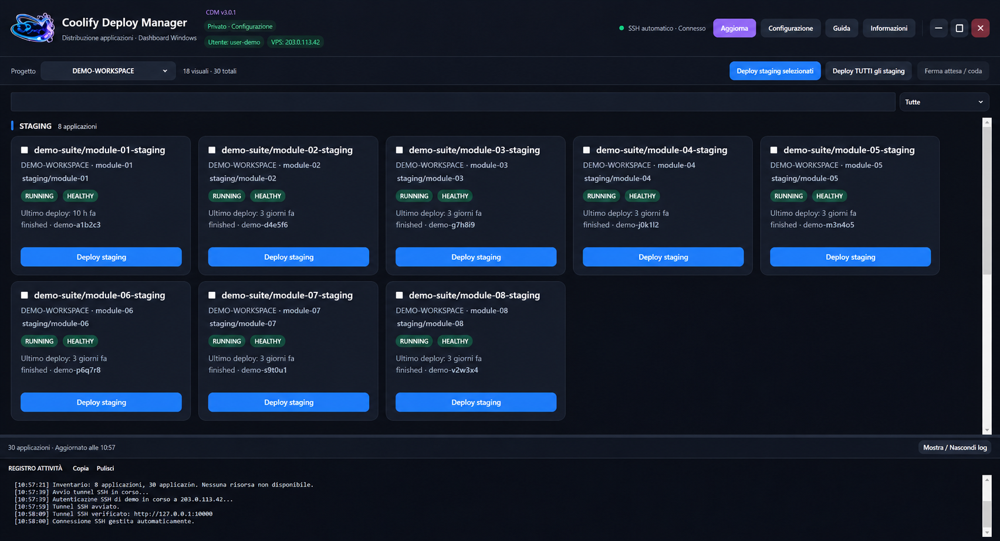
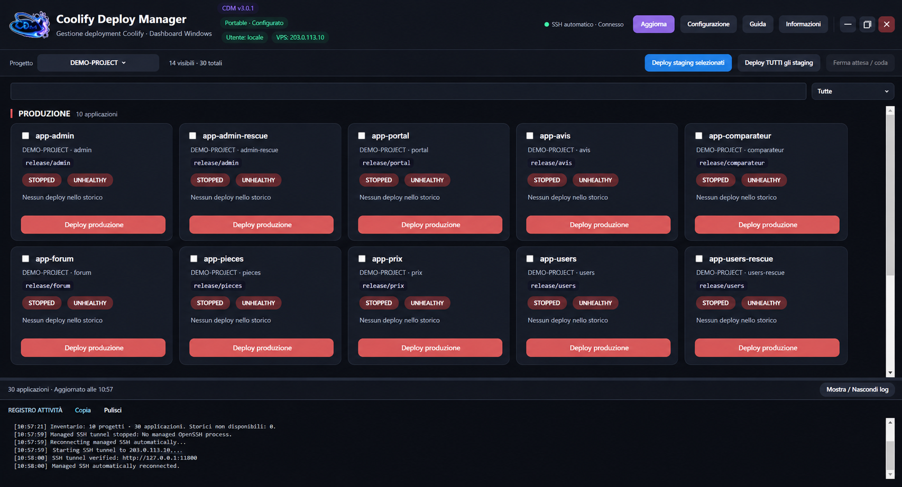

# CDM — Coolify Deploy Manager

**Versione 3.0.2 — Windows 10/11 x64 — applicazione indipendente e non ufficiale per Coolify.**

**Stato della release:** sorgenti e build locale verificati; la release pubblica v3.0.2 **non è ancora stata pubblicata**. Quando sarà disponibile si troverà nella pagina [GitHub Releases](https://github.com/Cris0338/CDM-Coolify-Deploy-Manager/releases).

**Autore:** [Cris0338](https://github.com/Cris0338) · © 2026. CDM non è affiliato né approvato da Coolify. [README inglese](README.md) · [Guida setup](CDM_SETUP_GUIDE.md) · [Compilazione](BUILDING.md) · [Licenza](LICENSE) · [Supporto volontario](SUPPORT.md).

## Funzioni principali

- Dashboard di progetti e applicazioni Coolify, classificazione staging/production, salute dei servizi e attività di deploy.
- Deploy avviati esplicitamente, avanzamento delle card, nuovi log di compilazione e indicatori nella barra applicazioni/tray.
- Riordino delle card, blocco posizione/deploy, ripristino progetto selezionato e geometria finestra.
- Wizard iniziale e Guida affiancati e indipendenti; gestione delle voci CDM nell'avvio automatico di Windows.
- Accesso diretto HTTPS attendibile, rete locale/VPN o tunnel SSH limitato verso il Coolify sul VPS.
- Traduzioni complete EN, FR e IT; altre lingue in anteprima con ripiego all'inglese.

## Immagini dimostrative

Le immagini contengono **dati anonimi e dimostrativi**, non screenshot di un server live.





## EXE generico ed EXE personale

- **Generico:** `CDM-v3.0.2.exe`, vergine, senza token, chiavi SSH, host o account preconfigurati. È il solo tipo di EXE da distribuire pubblicamente.
- **Personale:** `CDM-<utente>-<server>-v3.0.2.exe`, contiene nell'eseguibile la configurazione del server, il token Coolify, la chiave SSH dedicata e l'impronta host se usate, oltre alle preferenze. Il profilo **non è cifrato**. Non distribuire mai cloni personali né backup.

## Prima configurazione

1. Avvia l'EXE generico: wizard e Guida si aprono affiancati e restano indipendenti.
2. Scegli HTTPS attendibile, rete privata oppure tunnel SSH gestito, utile per VPS con Coolify raggiungibile via HTTP.
3. Per SSH inserisci nome host/IP del VPS, utente Linux amministratore esistente, porta SSH e porta Windows locale (di solito `18000`). La destinazione tipica sul VPS è `127.0.0.1:8000`.
4. Genera una chiave Ed25519 dedicata e copia il comando sul terminale autorizzato del VPS. Lo script crea un utente Linux limitato `<admin>-cdm`, separato dall'utente amministratore.
5. Verifica in modo indipendente l'impronta SSH del VPS e il funzionamento del tunnel, incluso il blocco della shell remota.
6. Genera un token Coolify con soli privilegi **READ + DEPLOY**, senza ROOT, WRITE o READ:SENSITIVE. Il controllo API iniziale è in sola lettura e non dimostra da solo il permesso deploy.
7. Salva per creare l'EXE personale. Nessun deploy viene avviato dal wizard.

Approfondimenti: [CDM_SETUP_GUIDE.md](CDM_SETUP_GUIDE.md).

## Aggiornare cloni personali 3.0.0 / 3.0.1

Con il vecchio CDM chiuso completamente, anche dalla tray, avvia il generico 3.0.2 specificando il percorso reale del tuo clone personale:

```powershell
& ".\CDM-v3.0.2.exe" --refresh-v3-clone "C:\Percorso\Al\Tuo-CDM-personale-v3.0.1.exe"
```

Il percorso è illustrativo. Solo cloni v3 originali idonei e con profilo valido possono essere aggiornati. **Il passaggio da cloni v2.x è vietato dal programma.** Conserva una copia privata del tuo EXE personale prima di un aggiornamento reale.

## Compilazione e distribuzione

Compilazione locale Windows x64 con SDK .NET 10: [BUILDING.md](BUILDING.md). Procedura di rilascio: [RELEASE_GUIDE.md](RELEASE_GUIDE.md). **Nessuna GitHub Actions**.

La [licenza CDM di ridistribuzione gratuita v1.0](LICENSE) consente uso personale e professionale, studio, modifiche e condivisione gratuita con attribuzione. La rivendita richiede un permesso distinto. Non è una licenza open source approvata OSI.

Se smarrisci un EXE personale, `.pending` o `.bak`, revoca separatamente il token Coolify e la chiave pubblica SSH dedicata. La revoca del token non disabilita il tunnel SSH.

Supporto facoltativo: [PayPal.Me Cris0338](https://www.paypal.com/paypalme/Cris0338/).
